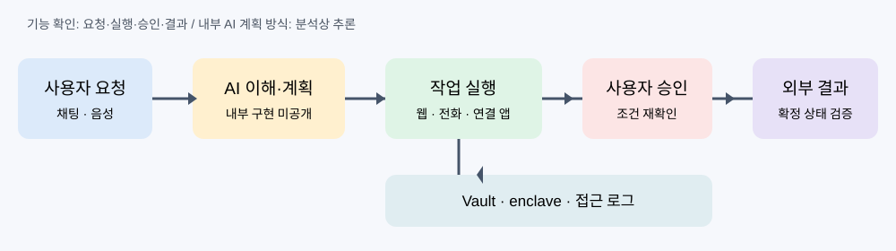

# 03. 작업 위임

*그림: [Pickle 공식 작업 안내](https://pickle.com/help/tasks/delegate)와 [공개 자격 증명 처리 소스](https://github.com/pickle-com/credential-enclave/blob/cff16a343bf5bb7953e5b65df6ab3600107e127d/README.md)를 바탕으로 이 책에서 작성한 분석 도식. AI 내부 계획 방식은 미공개입니다.*

Pickle에게 일을 맡기면 말이 실제 행동으로 이어질 수 있습니다. 회사는 자체 브라우저로 웹사이트를 이용하고, 온라인으로 처리하기 어려운 일에는 전화를 건다고 안내합니다. 따라서 “찾아줘”, “문의해 줘”, “확정해 줘”는 서로 다른 수준의 요청입니다. [작업 위임 안내](https://www.pickle.com/help/tasks/delegate)

## 공식 안내에 나온 기본 흐름

1. Chat에서 원하는 일을 설명합니다.
2. Pickle이 필요한 세부 정보를 묻거나 선택지를 제시합니다.
3. 실행 내용과 조건이 적힌 카드를 검토합니다.
4. 카드에서 허용한 범위의 작업이 진행됩니다. 작업 카드는 앱을 닫아도 대화에서 볼 수 있다고 회사가 설명합니다.
5. 완료 보고와 함께 예약 확인 링크 또는 화면 같은 결과물을 확인합니다. [작업 위임 안내](https://www.pickle.com/help/tasks/delegate)

## 카드에서 읽을 항목

| 항목 | 스스로 묻기 |
| --- | --- |
| 대상 | 어느 사이트·업체·사람에게 행동하나요? |
| 행동 | 문의만 하나요, 예약·구매·취소를 확정하나요? |
| 조건 | 날짜, 인원, 가격, 취소 규칙이 맞나요? |
| 정보 | 어떤 이름·연락처·계정 정보를 전달하나요? |
| 범위 | 이번 한 번인가요, 나중에도 적용되나요? |

이 표는 이 매뉴얼의 **검토 방법**입니다. 실제 카드가 모든 항목을 항상 표시한다는 뜻은 아닙니다. 빠진 정보가 중요하다면 승인 전에 채팅에서 다시 확인하세요.

## 완료 확인

| Pickle의 상태 | 사용자가 확인할 것 |
| --- | --- |
| 후보를 찾음 | 가격·시간·위치가 요청 조건과 맞는지 |
| 연락을 시도함 | 상대방과 실제로 연결됐는지, 약속이 생겼는지 |
| 예약을 마침 | 예약 번호, 확인 메시지, 상대 사이트의 예약 내역 |
| 취소를 요청함 | 취소 확정 여부, 환불 또는 수수료 |

Pickle의 보고는 출발점입니다. 회사도 실수가 있을 수 있으므로 카드와 결과를 확인하라고 안내합니다. 특히 오류 뒤 다시 시도할 때는 외부 사이트에 이미 처리가 됐는지 먼저 조회해야 중복 예약·중복 결제를 피할 수 있습니다. [작업 위임 안내](https://www.pickle.com/help/tasks/delegate), [서비스 약관](https://www.pickle.com/ko/terms-of-service)

## 권장 연습

첫 주에는 **결과가 외부에 영향을 주지 않는 요청** 두세 개로 시작하세요. 후보 비교가 잘 되는지, 제시한 근거를 읽을 수 있는지, 요청을 정정했을 때 반영되는지를 살펴보세요. 그다음 예약 문의와 같은 단계로 넓히는 것이 좋습니다.

> **기술 분석:** 웹 작업은 보통 `관찰 → 판단 → 행동 → 재관찰`의 반복으로 설명할 수 있습니다. 이 반복은 공개된 Pickle 내부 알고리즘이 아니라 기능에서 도출한 분석 모델입니다. 클릭이나 제출 화면만으로 완료를 판단하면 중복 실행이 생길 수 있습니다. [11장](11-system-architecture.md)의 성공 조건과 [12장](12-ai-techniques.md)의 웹 에이전트 평가 지표를 함께 보세요.
