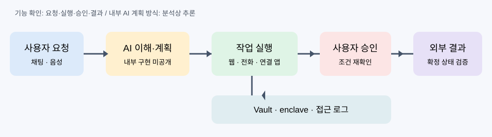

# 11. 피클 에이전트의 시스템 구조: 확인 사실과 추론

> **분석 기준: 2026년 11월 17일.** 이 장은 [Pickle 공식 도움말](https://pickle.com/help/start/what-is-pickle)과 공개된 [`credential-enclave` 소스](https://github.com/pickle-com/credential-enclave/tree/cff16a343bf5bb7953e5b65df6ab3600107e127d)를 읽은 결과다. 공개 소스는 **자격 증명 처리 구성 요소**를 설명한다. 피클 전체 AI 모델과 운영 환경의 독립 검증을 뜻하지 않는다.

## 연구 질문과 증거의 수준

“피클에는 어떤 AI 기술이 쓰였나?”라는 질문은 적어도 세 부분으로 나뉜다. 사용자의 말을 이해하고 계획하는 **AI 계층**, 웹·전화·연결 앱을 조작하는 **실행 계층**, 로그인·결제 정보와 작업 기록을 다루는 **보안 계층**이다. 세 계층의 공개 정도가 다르므로, 모두 같은 확신도로 설명하면 안 된다.

| 표시 | 뜻 | 이 책의 예 |
| --- | --- | --- |
| **확인** | 회사의 제품 문서나 공개 소스가 명시한다 | 피클은 웹 브라우저와 전화를 이용해 작업한다. |
| **구현 기반 추론** | 공개 기능을 실현하는 일반적 방법이지만 내부 코드는 공개되지 않았다 | 웹 화면을 보고 다음 클릭을 정하는 인식·계획·행동 반복이 필요하다. |
| **미확인** | 모델명, 학습 방법, 정확도 등 공개 증거가 없다 | 특정 LLM, 음성 인식 모델, 벤치마크 점수. |

따라서 “피클이 특정 모델로 화면을 읽는다”처럼 **가능한 설계**를 **제품의 확인된 구현**으로 바꾸어 쓰지 않는다. 공식 도움말이 보여 주는 것은 사용자 경험이고, 공개 저장소가 보여 주는 것은 자격 증명 경계다.

## 관찰 가능한 데이터 흐름

*그림: 실선은 공식 문서가 설명하는 기능 경로, 점선 성격의 ‘추론’ 표시는 기능을 설명하기 위한 논리적 분해다. [작업 도움말](https://pickle.com/help/tasks/delegate), [공개 저장소](https://github.com/pickle-com/credential-enclave/blob/cff16a343bf5bb7953e5b65df6ab3600107e127d/README.md)를 바탕으로 이 책에서 작성.*

| 단계 | 기술적으로 필요한 일 | 공개 증거와 경계 |
| --- | --- | --- |
| 입력 | 자연어·음성 요청을 작업 목표와 제약으로 바꾸기 | 채팅·통화는 제품 기능으로 확인. 모델 및 프롬프트 구조는 미공개. |
| 계획 | 하위 단계, 도구 선택, 종료 조건을 정하기 | 여러 단계의 웹·전화 작업은 확인. 내부 플래너는 추론. |
| 실행 | 브라우저, 전화, 연결 서비스와 상호작용 | 브라우저·전화·연결 서비스 사용은 공식 안내로 확인. |
| 승인 | 결제·예약 조건을 사용자가 검토 | 승인 카드가 공식 도움말에 설명됨. 어떤 조건을 서버가 강제하는지는 별도 검증 필요. |
| 자격 증명 | 암호·카드·OAuth 토큰을 보관하고 필요할 때 사용 | 이 부분은 공개 enclave 소스와 프로토콜로 구체적으로 분석 가능. |
| 결과 | 외부 서비스의 상태를 다시 읽어 사용자에게 보고 | 화면·이메일·예약번호의 사실 확인이 필요하며 AI의 완료 메시지 자체는 증빙이 아님. |

이 구분이 중요한 이유는 **언어 이해가 정확해도 외부 작업은 실패할 수 있고**, 안전한 저장소가 있어도 **저장소 밖으로 나온 데이터**는 별도 위험을 갖기 때문이다. 시스템 품질은 모델 하나의 점수보다 단계별 실패율과 복구 능력에 달려 있다.

## 에이전트의 핵심 반복

일반적인 웹 에이전트는 `관찰 → 목표와 현재 상태 비교 → 다음 행동 선택 → 실행 → 결과 재관찰`을 반복한다. 피클의 내부 알고리즘 공개 증거가 없으므로 이것은 **구현 기반 추론**이다. 예를 들어 식당 예약에서는 “예약 버튼 클릭”이 성공의 정의가 아니다. 날짜·인원·이름이 맞고, 사이트가 확정번호를 발급했는지까지 확인해야 한다. 네트워크 지연, 팝업, 로그인 만료, 가격 변경이 생기면 상태를 다시 읽고 계획을 고쳐야 한다.

작업의 성공 기준은 다음처럼 쓸 수 있다.

`성공 = 사용자 조건 충족 ∧ 외부 서비스 확정 상태 확인 ∧ 필요한 승인 완료`

이 식은 제품 코드의 공식 사양이 아니라 **독자용 검증 규칙**이다. [03장](https://wikidocs.net/471755)의 작업 지시와 [08장](https://wikidocs.net/471760)의 오류 복구에 적용한다.

## 공개 소스의 범위

공개 [`credential-enclave` README](https://github.com/pickle-com/credential-enclave/blob/cff16a343bf5bb7953e5b65df6ab3600107e127d/README.md)는 기기 쪽 secure program, Nitro Enclave 안의 node, host relay, 프로토콜, 검증 도구를 구분한다. 이 저장소는 **비밀 정보가 어디서 복호화되고 어떤 경로로 나가는지**를 자세히 설명하지만, 대화 모델의 가중치, 음성 처리 모델, 브라우저 조작 모델, 기억 검색 알고리즘은 공개하지 않는다. 따라서 이후 장에서도 보안 구조와 AI 구조의 증거 수준을 따로 표시한다.

## 이 장의 검증 가능한 결론

1. Pickle은 대화형 모델만으로 끝나는 제품이 아니라 외부 작업 실행과 상태 확인을 포함하는 **에이전트 시스템**이다.
2. 자격 증명 보호는 공개 소스에서 세밀하게 검토할 수 있다. **모든 AI 구성 요소가 공개되었다는 뜻은 아니다.**
3. “안전하게 보관”과 “작업 중 비밀이 절대 노출되지 않음”은 다른 주장이다. 구체적 경계는 [13장](https://wikidocs.net/491192)과 [14장](https://wikidocs.net/491193)에서 확인한다.

