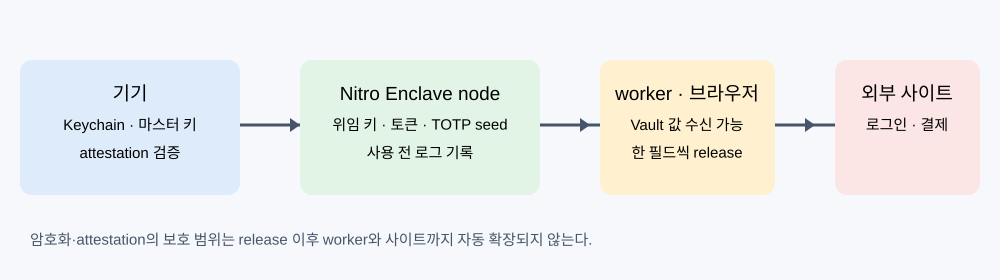

# 13. Vault의 암호화·키 위임·Nitro Enclave

> **소스 기준:** [`credential-enclave` commit `cff16a3`](https://github.com/pickle-com/credential-enclave/tree/cff16a343bf5bb7953e5b65df6ab3600107e127d), 2026년 11월 9일. 아래 설명은 공개 코드와 문서에 대한 **정적 분석**이다. 실제 계정의 실행 노드를 독립 검증한 결과는 아니다.

## 왜 ‘암호화된 저장’만으로 충분하지 않은가

예약 사이트에 로그인하려면 언젠가는 비밀번호를 입력해야 한다. 결제하려면 카드 번호를 결제 양식에 전달해야 한다. 따라서 핵심 질문은 “암호화되어 있나?”보다 **누가, 어느 순간에, 어떤 값의 평문을 볼 수 있나?**다. Pickle의 [로그인 저장 도움말](https://www.pickle.com/help/connect/save-login)과 [카드 저장 도움말](https://pickle.com/help/connect/save-card)은 Vault를 설명한다. 공개 소스는 Vault와 계정 연결의 경계를 더 자세히 보여 준다.

*그림: [`README`](https://github.com/pickle-com/credential-enclave/blob/cff16a343bf5bb7953e5b65df6ab3600107e127d/README.md), [`protocol.md`](https://github.com/pickle-com/credential-enclave/blob/cff16a343bf5bb7953e5b65df6ab3600107e127d/docs/protocol.md), [`egress-policy.md`](https://github.com/pickle-com/credential-enclave/blob/cff16a343bf5bb7953e5b65df6ab3600107e127d/docs/egress-policy.md)를 바탕으로 이 책에서 작성.*

## 키와 위임의 순서

1. 공개 소스는 기기의 **마스터 키**를 iCloud Keychain에 두고, 여기서 서명·로그 복호화·사용자 키를 파생한다고 설명한다. 이 설명은 해당 소스가 구현하는 경로에 한정된다.
2. 앱의 secure program은 실행 중인 node의 **AWS Nitro attestation**을 검증한다. attestation은 enclave가 주장하는 코드 측정값(PCR0·PCR1·PCR2)과 공개 키를 묶는다.
3. 앱은 사용자 키를 검증된 node의 공개 키로 봉인해 **최대 30일** 위임한다. node는 이를 메모리에서 사용한다.
4. operator backend는 암호문과 네트워크 바이트를 중계한다. 공개 소스의 보장 범위에서 OAuth 토큰과 TOTP seed는 node 밖으로 평문 반환되지 않는다.
5. 단, **Vault `release`는 필요한 비밀번호·카드 번호·CVC 또는 TOTP 코드 한 필드를 작업 실행 쪽에 넘긴다.** 넘긴 뒤의 평문은 enclave 내부 보호 범위 밖이다.

이 구조는 “운영자가 모든 비밀을 평문으로 보관한다”는 단순 구조보다 강한 경계를 제공하지만, **작업을 실행하는 브라우저·worker가 넘겨받은 값**까지 완전히 숨기는 구조는 아니다. 공개 README가 이 한계를 명시한다.

## 암호 기술을 정확하게 읽기

[`protocol.md`의 암호 표](https://github.com/pickle-com/credential-enclave/blob/cff16a343bf5bb7953e5b65df6ab3600107e127d/docs/protocol.md)에 따르면 키 파생에는 HKDF-SHA256, 서명에는 Ed25519, 위임 봉인에는 X25519·HKDF·ChaCha20-Poly1305를 조합한 HPKE base mode, 저장 레코드 암호화에는 ChaCha20-Poly1305를 사용한다. 레코드 암호문의 AAD는 계정·레코드·custody·provider 정보를 묶어 다른 맥락으로 옮겨 쓰는 오류를 줄인다.

| 용어 | 이 제품 구조에서의 역할 | 보장하지 않는 것 |
| --- | --- | --- |
| AEAD | 내용의 기밀성과 변조 탐지 | 평문이 작업 실행자에게 전달된 뒤의 비밀성 |
| HKDF | 마스터 키에서 용도별 키 파생 | 기기 자체나 앱 바이너리의 정직성 |
| HPKE | 확인된 node 공개 키로 위임 봉인 | 이후 모든 코드 버전의 동일한 정책 |
| Attestation | 실행 이미지 측정값과 공개 키를 연결 | 사용자가 그 이미지의 모든 동작을 이해했다는 뜻 |

Nitro의 attestation은 [AWS 공식 문서](https://docs.aws.amazon.com/enclaves/latest/user/set-up-attestation.html)의 기술에 기초한다. 하지만 **측정값 확인에는 신뢰할 소스 빌드 결과와 실행 노드의 문서를 실제로 비교하는 절차가 필요**하다. 소스를 읽은 것만으로 현재 서비스 노드가 같은 이미지를 실행 중이라고 단정할 수 없다.

## 가장 중요한 신뢰 경계: `release`

[`egress-policy.md`](https://github.com/pickle-com/credential-enclave/blob/cff16a343bf5bb7953e5b65df6ab3600107e127d/docs/egress-policy.md)의 분류에서 Vault 비밀번호·카드 번호·CVC는 `release`에 의해 한 필드씩 반환될 수 있다. TOTP는 seed 자체가 node에 남지만 **6자리 코드**가 반환될 수 있다. 반면 OAuth 토큰은 `release`가 거부한다. 이 차이는 실제 위험 평가에 직접 영향을 준다.

예를 들어 비밀번호를 사이트에 입력하는 작업에서는 **사이트, 브라우저 실행 환경, 값을 전달받은 worker**를 신뢰해야 한다. 카드 입력 작업에서는 금액·상점·결제 대상 확인이 추가로 필요하다. 그래서 [04장](https://wikidocs.net/471756)의 결제 승인과 [07장](https://wikidocs.net/471759)의 데이터 공유를 별도로 점검해야 한다.

## 철회와 업데이트의 한계

공개 README에 따르면 위임 철회 요청은 operator 경유로 살아 있는 node에 전달된다. operator가 살아 있는 node를 목록에서 누락하면, 그 node는 위임 만료까지 사용자 키를 유지할 수 있다. 만료 상한은 30일이다. 또한 operator는 공개 투명성 로그에 기록된 **새 release**로 위임을 이전할 수 있으며, 이전 전 별도 통지 기간은 없다. 이는 “코드가 공개되었으니 미래 버전도 자동으로 같은 보호 수준”이라는 추론을 막는다. 구체적인 접근 기록 검증은 [15장](https://wikidocs.net/491194)에서 다룬다.

