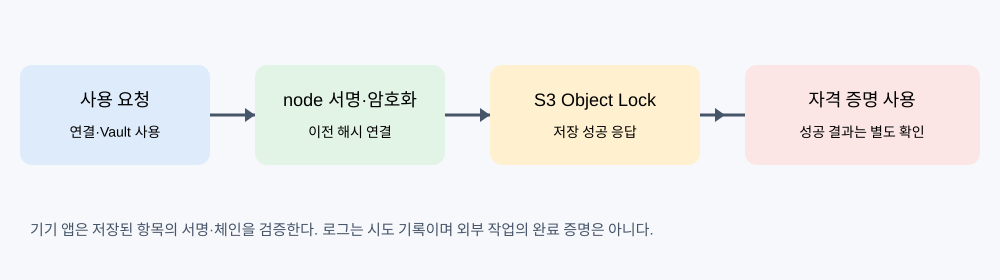

# 15. 접근 로그: 사용 전 기록, 검증, 사각지대

> 분석 자료: [공식 접근 로그 안내](https://pickle.com/help/privacy/activity), [`credential-enclave` README](https://github.com/pickle-com/credential-enclave/blob/cff16a343bf5bb7953e5b65df6ab3600107e127d/README.md), [`protocol.md` 7장](https://github.com/pickle-com/credential-enclave/blob/cff16a343bf5bb7953e5b65df6ab3600107e127d/docs/protocol.md). **로그가 있다는 사실과 개별 작업의 성공은 동일하지 않다.**

## 기록의 인과 순서

공개 소스의 핵심 설계는 자격 증명을 사용하기 **전에** 로그 항목을 S3 Object Lock 저장소에 쓰고, 저장소가 성공 응답을 준 뒤에 작업을 진행하는 것이다. node는 항목에 서명하고 이전 항목과 해시로 연결한다. 기기 앱은 자기 키로 암호화된 내용을 읽고 체인을 검증한다. [AWS S3 Object Lock의 compliance mode](https://docs.aws.amazon.com/AmazonS3/latest/userguide/object-lock.html)는 지정 보존 기간 동안 객체 버전을 덮어쓰거나 삭제하지 못하게 한다. 이 공개 소스의 보존 설정은 **365일**이다.

*그림: 공개 [`README`](https://github.com/pickle-com/credential-enclave/blob/cff16a343bf5bb7953e5b65df6ab3600107e127d/README.md)와 [접근 로그 안내](https://pickle.com/help/privacy/activity)를 바탕으로 이 책에서 작성.*

이를 간단히 쓰면 다음과 같다.

`사용 허용 조건 = 유효한 위임 ∧ 대상 작업 허용 ∧ 로그 저장 성공`

단, 이 식은 설계 핵심을 설명하는 축약이며 모든 세부 정책이 enclave 내부에서 강제됨을 뜻하지 않는다. [`protocol.md`의 `policy` 필드](https://github.com/pickle-com/credential-enclave/blob/cff16a343bf5bb7953e5b65df6ab3600107e127d/docs/protocol.md)는 현재 단계에서 빈 객체로 취급되므로 **앱의 승인 UI를 enclave의 세부 승인 강제로 착각하면 안 된다.**

## 로그에서 증명할 수 있는 것

| 관찰 | 가능한 결론 | 불가능한 결론 |
| --- | --- | --- |
| 서명·체인이 유효한 `release` 기록 | 해당 node가 비밀 값을 내보내려는 행위를 기록했다 | 사이트 로그인이나 결제가 성공했다 |
| `forward` 기록 | 특정 provider 요청을 시작하려 했다 | provider가 요청을 받아 처리했다 |
| 기록이 보이지 않음 | 현재 앱 조회 범위에 해당 항목이 없다 | 모든 node에서 절대 사용이 없었다 |
| S3 저장 실패 | 소스 설계상 해당 node가 비밀 사용을 중단해야 한다 | 서비스 전체가 정상 동작했다 |

로그는 **행동의 의도와 시도**에 대한 증거다. 예약 확정번호, 카드 승인 내역, provider의 감사 로그 같은 외부 증거와 결합해야 실제 결과를 알 수 있다. 또한 작업이 실패하거나 시작되지 않아도 선행 기록은 남을 수 있다.

## 검증의 한계

공개 README는 네 가지 경계를 밝힌다. 첫째, node가 정상 종료하지 못해 최종 `head`를 남기지 않으면 **마지막으로 확인된 지점 이후 기록의 체인 검증이 불완전**할 수 있다. 둘째, 철회 요청에서 operator가 살아 있는 node를 누락하면 위임 만료까지 최대 30일의 잔여 권한이 남을 수 있다. 셋째, 저장소 보존과 가용성은 AWS 및 operator 계정의 지속성에 의존한다. 넷째, 새로운 release로의 위임 이전을 기록하는 Sigstore Rekor 검증은 **signed entry timestamp를 확인하지만 node 쪽에서 inclusion proof와 checkpoint까지 확인하지 않는다**. [Rekor의 증명 구조](https://docs.sigstore.dev/logging/overview/)를 아는 독자라면 이 차이가 장기 포함성의 강도를 바꾼다는 점을 이해해야 한다.

## 독자가 실제로 점검할 순서

1. 피클 앱의 [접근 로그](https://pickle.com/help/privacy/activity)에서 **어느 연결·어느 시각·어떤 행위**였는지 본다.
2. 승인 카드, 작업 요청, 접근 로그의 시각과 대상을 맞춰 본다.
3. 결제·예약·메일 전송은 해당 사이트의 내역으로 **결과를 별도 확인**한다.
4. 이상하면 피클 연결을 해제하고, provider 계정의 연결 앱 권한과 카드·비밀번호 상태를 직접 점검한다.
5. 접근 로그가 비어 있어도 앱 오류·동기화 지연·검증 불완전 표시를 확인한다.

이 순서는 포렌식 완결 절차가 아니라 일반 사용자의 검토 절차다. 전문 감사를 한다면 release 측정값, attestation, S3 객체, 앱의 검증 결과, 외부 provider 기록을 함께 확보해야 한다.

