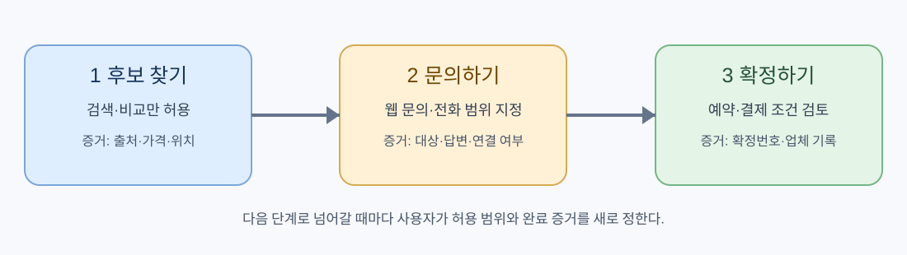

# 17. 피클 AI에 첫 작업 맡기기: 요청부터 완료 확인까지

> **자료 재확인: 2026년 11월 24일.** Pickle의 [작업 위임](https://www.pickle.com/help/tasks/delegate), [앱 화면](https://www.pickle.com/help/start/app-layout), [결제 전 확인](https://www.pickle.com/help/tasks/confirm-before-payment), [접근 로그](https://www.pickle.com/help/privacy/activity) 공식 안내를 바탕으로 작성했습니다. 식당 사례와 아래 대화문은 **설명을 위해 구성한 예시**입니다. 저자가 실제 계정으로 예약·통화 성공을 시험한 기록이 아닙니다. 앱 화면과 이용 조건은 지역·시점에 따라 확인하세요.

피클을 처음 켰을 때 “식당 좀 찾아줘”라고 말하는 것은 쉽습니다. 어려운 부분은 그다음입니다. 피클이 후보를 찾는 데서 멈춰야 하는지, 가게에 전화를 걸어도 되는지, 예약을 확정해도 되는지 사용자가 정해야 합니다. 첫 작업의 목표는 AI에게 많은 권한을 주는 것이 아니라 **내가 정한 경계 안에서 결과를 받아보고 검증하는 경험**을 쌓는 것입니다.

## 1분 요약: 첫 작업은 세 단계로 나누세요

*그림: [Pickle의 작업 위임·승인 안내](https://www.pickle.com/help/tasks/delegate)를 바탕으로 이 책에서 만든 의사결정 도식입니다. 실제 앱 화면이나 내부 AI 알고리즘을 재현한 그림은 아닙니다.*

| 단계 | 피클에게 허용하는 행동 | 사용자가 확인할 증거 | 처음부터 필요한가요? |
| --- | --- | --- | --- |
| **후보 찾기** | 공개 정보 검색·비교 | 업체명·위치·가격·출처. 출처가 없으면 보류 | 예. 첫 실습으로 적합 |
| **문의하기** | 웹 문의 또는 업체에 전화 | 문의 대상·전달한 정보·실제 답변. 답변이 없으면 실패로 기록 | 후보를 고른 뒤 선택 |
| **확정하기** | 예약 제출·결제 등 외부 상태 변경 | 업체의 확정번호·예약 내역. 확인되지 않으면 완료 판정 보류 | 마지막에 별도 결정 |

단계를 나누면 “좋은 후보를 찾았다”와 “예약이 확정됐다”를 혼동하지 않을 수 있습니다. Pickle은 웹사이트에서 작업하고 필요하면 전화를 걸며, 작업 전 실행 내용과 조건을 카드로 보여 준다고 [공식 도움말](https://www.pickle.com/help/tasks/delegate)에 설명합니다. 카드가 나왔다는 사실과 사용자가 승인한 범위는 실제 화면에서 다시 읽어야 합니다.

## 시작 전 3분 점검

이 실습은 **결제 수단이나 사이트 로그인 저장 없이 후보만 찾는 단계**부터 시작합니다. 현재 계정의 사용 가능 여부, 플랜, 사용량은 앱에서 확인하세요. 공식 영어 도움말은 [주간 한도](https://www.pickle.com/help/credits/usage-credits)를 설명하지만, 앞서 확인한 한국어 안내와 조건이 달라 [10장](https://wikidocs.net/471762)에 차이를 기록했습니다.

| 내가 정할 값 | 식당 예시 | 비워 두면 생기는 문제 |
| --- | --- | --- |
| 날짜·시간 | 다음 주 토요일 오후 7시 | 다른 날의 빈자리를 제안할 수 있음 |
| 인원 | 성인 2명 | 예약 가능 여부를 잘못 비교할 수 있음 |
| 지역 | 강남역에서 도보 15분 | 이동하기 어려운 후보가 섞임 |
| 예산 | 1인 식사비 5만 원 이하 | 비싼 후보를 걸러내기 어려움 |
| 행동 경계 | 전화·예약·결제 금지 | 정보 검색을 외부 행동으로 넓게 해석할 수 있음 |
| 결과 형식 | 후보 3곳과 확인한 출처 | 그럴듯한 요약만 받고 사실을 확인하기 어려움 |

이 값은 **예시**입니다. 실제 요청에는 본인의 일정과 예산을 넣고, 알레르기나 이동 제약처럼 빠지면 안 되는 조건이 있다면 별도로 적으세요. 개인정보는 검색에 꼭 필요한 범위만 제공하세요.

## 1단계. 후보만 찾는 요청을 보내세요

앱의 **Chat**에서 다음 문장을 자신의 조건으로 바꾸어 보냅니다. [앱 구성 도움말](https://www.pickle.com/help/start/app-layout)은 Chat과 제안 카드가 있는 Explore를 구분합니다. Explore에서 시작하더라도, 제안 문장이 Chat으로 옮겨졌을 때 조건을 다시 읽는 편이 좋습니다.

> “다음 주 토요일 오후 7시에 성인 2명이 갈 식당 후보를 강남역 도보 15분 안에서 세 곳 찾아줘. 1인 식사비는 5만 원 이하로 보고, 위치·가격·예약 가능 여부를 확인한 출처와 함께 표로 보여 줘. **전화, 예약 제출, 결제는 하지 마.** 확인이 어려운 항목은 추측하지 말고 ‘미확인’이라고 표시해 줘.”

이 요청의 마지막 두 문장이 핵심입니다. 피클이 세 곳을 제시하더라도 영업시간이나 빈자리 정보가 오래됐을 수 있으므로 **출처와 확인 시점**을 읽습니다. 후보가 조건에 맞지 않으면 “세 번째 후보는 지역 조건을 벗어났어. 다시 찾아줘”처럼 **한 가지 오류와 수정 기준**을 짚어 주세요.

| 피클의 응답에서 보이는 것 | 다음 행동 |
| --- | --- |
| 후보·조건·출처가 모두 있음 | 원본 사이트를 열어 날짜·가격을 한 번 확인 |
| 가격 또는 빈자리가 ‘미확인’ | 확인 가능한 방법을 질문; 예약으로 바로 넘어가지 않기 |
| 조건과 다른 후보가 있음 | 잘못된 조건을 지정해 다시 비교 요청 |
| 연락·예약을 제안함 | 아직 허용하지 않았다면 후보 검토에서 멈추기 |

첫 단계의 **성공**은 후보마다 업체명·위치·가격 근거가 있고, 지역·예산 조건을 어기지 않아 **검토할 자료를 받은 상태**입니다. 근거가 없거나 조건을 벗어난 후보가 섞였다면 수정이 필요한 **미완료**로 기록하세요. 요청 날짜와 인원의 빈자리가 확인되지 않았어도 ‘미확인’으로 분명히 표시됐다면 후보 비교는 끝낼 수 있습니다. 어느 경우에도 외부 업체와 약속이 생긴 상태는 아닙니다.

## 2단계. 필요할 때만 문의 범위를 허용하세요

후보 중 하나를 고른 뒤, 온라인 정보만으로 빈자리를 확인할 수 없다면 문의를 따로 요청합니다. Pickle은 온라인에서 처리하기 어려운 일에 [전화를 걸 수 있다고 안내](https://www.pickle.com/help/tasks/delegate)합니다. 전화할 때는 상대에게 전달할 이름·연락처와 **약속할 수 없는 내용**을 먼저 정해야 합니다.

> “첫 번째 식당에 토요일 오후 7시 성인 2명 자리가 있는지만 문의해 줘. 필요한 정보가 있으면 전화 전에 나에게 물어봐. **예약 확정, 예약금 동의, 개인정보 추가 제공은 하지 마.** 통화 결과에서 ‘가능하다고 안내받음’과 ‘예약 확정’을 구분해서 알려 줘.”

문의 단계의 **성공**은 지정한 업체에 실제로 연락해 날짜·시간·인원을 물었고, 답변을 확인할 수 있는 상태입니다. 연결되지 않았거나 상대 답변을 확인할 수 없다면 **문의 실패**입니다. 상대가 “가능할 것 같습니다”라고만 말했다면 문의는 끝났어도 **예약은 확정되지 않았습니다.** 공식 도움말은 피클이 건 전화의 기록을 앱의 [Other chats](https://www.pickle.com/help/chat/other-chats)에서 볼 수 있다고 설명합니다. 통화 요약만으로 확정 여부가 불분명하면 업체에 다시 확인하세요.

## 3단계. 예약을 맡길 때는 조건 카드부터 확인하세요

예약을 확정하고 싶다면 새 요청에서 **대상, 날짜, 인원, 비용, 취소 조건, 승인 범위**를 명시합니다.

> “첫 번째 식당의 토요일 오후 7시, 성인 2명 자리를 예약해 줘. 예약금이 없고 취소 수수료가 없는 조건에서만 진행해 줘. 조건이 다르거나 신용카드가 필요하면 확정 전에 보여 줘. 완료되면 **예약 번호 또는 업체의 확인 화면**을 알려 줘.”

Pickle의 [작업 안내](https://www.pickle.com/help/tasks/delegate)는 진행 전 행동과 조건을 적은 카드를 보여 준다고 설명합니다. 다만 사용자가 이미 금액·행동을 구체적으로 허용했다면 같은 내용에 대해 다시 묻지 않을 수 있다고 [결제 안내](https://www.pickle.com/help/tasks/confirm-before-payment)는 설명합니다. **매번 승인 팝업이 나온다고 가정하지 말고**, 내가 앞서 어떤 범위를 허용했는지까지 읽어야 합니다.

| 카드에서 읽을 것 | 원래 요청과 다르면 |
| --- | --- |
| 정확한 업체·지점·날짜·시간·인원 | 승인하지 말고 수정 요청 |
| 예약금·세금·수수료를 포함한 총액 | 차액과 이유를 확인할 때까지 보류 |
| 취소 기한·환불 규칙 | 감당할 수 있는 조건인지 직접 판단 |
| 입력할 이름·연락처·계정 | 꼭 필요한 정보인지 확인 |
| 한 번의 예약인지, 반복·후속 행동까지 허용하는지 | 범위를 좁혀 다시 지시 |

돈이 드는 작업에서 금액이 높아지면 피클이 차이를 보여 주고 다시 묻는다고 회사는 [결제 도움말](https://www.pickle.com/help/tasks/confirm-before-payment)에 적습니다. 이 책의 표는 **사용자 검토 목록**이며, 실제 카드가 모든 칸을 항상 보여 준다는 주장이 아닙니다. 누락된 조건이 중요하면 승인 전에 채팅으로 묻습니다.

## ‘끝났다’는 말을 증거로 바꾸세요

*화면 출처: [Pickle 공식 도움말 ― 진행 중인 일 확인하고 취소하기](https://www.pickle.com/help/tasks/check-and-cancel), 2026년 11월 19일 재확인. 실제 계정 화면은 달라질 수 있습니다.*

Pickle은 예약을 마치면 **확인 링크 또는 확인 화면**을 보낸다고 [작업 안내](https://www.pickle.com/help/tasks/delegate)에 적습니다. 그 링크에서 날짜·인원·지점·예약자 이름을 다시 확인하세요. 필요하다면 업체 사이트의 ‘내 예약’ 또는 확인 문자·이메일도 대조합니다.

| 보이는 결과 | 해석 | 다음 확인 |
| --- | --- | --- |
| “후보를 찾았어요” | 정보 제공 완료 | 원본 정보의 정확성 |
| “전화했어요” | 통화 시도 또는 종료 | 연결 여부와 실제 대화 내용 |
| “예약을 진행했어요” | 진행 과정일 수 있음 | 업체의 확정번호·예약 내역 |
| 확인번호와 업체 기록이 일치 | 예약 완료의 강한 증거 | 취소 기한을 캘린더에 기록 |
| 오류 화면만 있음 | 성공·실패 어느 쪽도 단정 불가 | 업체·카드 내역 확인 후 재시도 |

예약 단계는 **확정·미확정·확인 중** 세 상태로 판정하세요. 업체의 확인번호나 예약 내역이 요청한 날짜·인원·지점과 일치하면 **확정**입니다. 업체가 거절했거나 취소를 알렸다면 **미확정**입니다. 피클이 완료라고 보고했지만 업체 기록이 없고 연락도 닿지 않는다면 **확인 중**입니다. 이때 같은 예약을 다시 제출하면 중복될 수 있으므로 확인 전 재시도하지 않습니다.

자격 증명을 썼다면 [접근 로그](https://www.pickle.com/help/privacy/activity)도 볼 수 있습니다. 다만 15장에서 분석한 공개 enclave 로그는 **비밀 사용 행위의 선행 기록**을 다룹니다. 이 로그의 존재는 예약의 외부 성공 증거가 아닙니다. 현재 앱 화면에 표시되는 기록 범위도 실제 계정에서 확인해야 합니다.

## 막혔을 때: 재시도 전에 확인할 세 가지

1. **이미 접수됐는가?** 예약 내역·문자·이메일·카드 승인 내역을 확인합니다.
2. **어디서 멈췄는가?** 피클의 작업 카드와 업체 화면의 상태를 구분합니다.
3. **다시 실행하면 중복되는가?** 업체 기록이 확인되기 전에는 같은 예약·결제를 재제출하지 않습니다.

> “지금은 재시도하지 마. 업체 쪽에 이미 예약이 생겼는지 확인 가능한 정보부터 보여 줘. 확인되지 않으면 ‘확인되지 않음’으로 알려 줘.”

로그인·인증 단계에서 멈췄다면 비밀번호를 일반 채팅에 보내지 마세요. 회사는 [Vault 로그인 카드](https://www.pickle.com/help/connect/save-login)를 안내합니다. 본인에게 추가 인증을 요구하는 화면이 나오면 해당 서비스의 안내에 따라 직접 확인하세요. **인증 화면을 통과한 사실도 예약 확정의 증거는 아닙니다.** 더 자세한 복구 순서는 [08장](https://wikidocs.net/471760)을 참고하세요.

## 기술적으로는 무엇을 확인한 셈일까요?

첫 작업은 AI의 답변 품질만 보는 시험이 아닙니다. **요청 해석 → 웹·전화 도구 선택 → 외부 상태 읽기 → 사용자 승인 → 결과 재검증**이라는 시스템 전체를 점검하는 일입니다. 이 흐름은 기능을 설명하기 위한 분석 모델이며, 피클의 비공개 모델·프롬프트·브라우저 제어 코드가 그대로 이렇게 구현됐다는 주장은 아닙니다. 기술 구조는 [11장](https://wikidocs.net/491190), 보안 경계는 [13장](https://wikidocs.net/491192), 기록의 한계는 [15장](https://wikidocs.net/491194)에서 더 깊게 다룹니다.

## 복사해서 쓰는 첫 작업 기록표

| 기록할 항목 | 내 답 |
| --- | --- |
| 요청한 목표와 금지한 행동 |  |
| 피클이 제시한 후보와 출처 |  |
| 내가 허용한 문의·예약 범위 |  |
| 카드에서 확인한 비용·취소 조건 |  |
| 피클이 보고한 결과 |  |
| 업체에서 직접 확인한 결과 |  |
| 다음에 요청문에서 고칠 한 가지 |  |

첫 시도에서는 마지막 칸이 가장 중요합니다. 피클이 어떤 질문을 더 했는지, 어떤 조건을 놓쳤는지 적어 두면 다음 요청을 짧고 정확하게 바꿀 수 있습니다.

## 이 실습을 다른 일에 옮기기

식당이라는 소재를 빼면 이 장의 구조는 다른 업무에도 쓰입니다. 예를 들어 병원 예약이라면 **의료 정보와 예약 확정**, 상품 구매라면 **배송지와 결제**, 구독 해지라면 **해지 효력과 환불 조건**이 새로 중요해집니다. 다음 표의 빈칸을 채워 자기 업무에 맞게 바꿔 보세요.

| 바꿀 요소 | 식당 사례 | 내 업무 |
| --- | --- | --- |
| 먼저 조사할 후보 | 식당 세 곳 |  |
| 외부에 연락할 때 전달할 정보 | 날짜·시간·인원 |  |
| 승인이 필요한 행동 | 예약 확정·예약금 결제 |  |
| 성공을 확인할 외부 기록 | 업체 예약번호·내역 |  |
| 실패 뒤 중복될 수 있는 행동 | 같은 시간의 재예약·재결제 |  |

이 표를 채우다 보면 처음에는 보이지 않았던 위험이 드러납니다. 예를 들어 구독 해지는 “해지 요청 접수”와 “다음 결제가 멈춤”이 다른 상태입니다. **완료 증거를 먼저 정하면** 피클에게 무엇을 보고하게 할지도 분명해집니다. 이 역시 작업 설계 연습이며 특정 서비스의 실제 성공 사례는 아닙니다.

## 독자와 함께 이야기하기

이 책의 예시를 자신의 업무에 맞게 바꾸거나 읽으면서 생긴 질문을 나누고 싶다면 [카카오톡 오픈채팅방](https://open.kakao.com/o/glN01iXi)을 이용하세요. **이 방은 Pickle.com의 공식 고객지원 채널이 아닙니다.** 비밀번호·인증번호·카드 정보, 다른 사람의 예약 내역이나 연락처는 올리지 마세요. 제품 장애나 계정 문제는 [Pickle 공식 도움말](https://www.pickle.com/help)의 문의 경로로 전달하는 것이 정확합니다.

