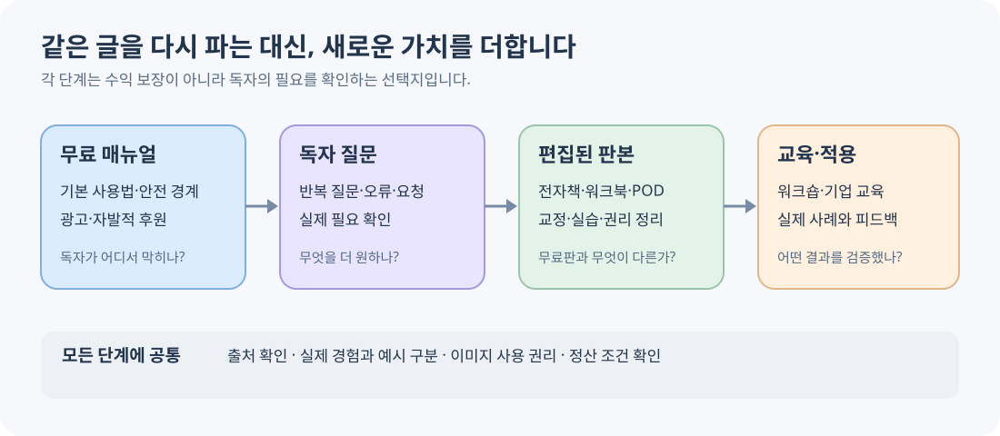

# 19. 저자를 위한 부록: 이 매뉴얼을 출판하고 수익화하기

> **조사일: 2026년 11월 24일.** 이 장은 Pickle의 수익 모델이나 제휴 프로그램을 설명하지 않습니다. 이 책의 원고를 만든 저자가 선택할 수 있는 **콘텐츠 출판·교육 방식**을 비교합니다. 금액과 배분율은 각 서비스의 공개 안내에 근거하며, 실제 매출이나 장래 수익을 약속하지 않습니다. 참고자료는 별도 목록 대신 해당 설명에 연결했습니다.

조회수가 잘 나온다는 사실은 반가운 신호입니다. 하지만 조회수는 책을 구매할 의향, 강의를 들을 의향, 실제로 일을 맡겨 본 경험을 각각 증명하지는 않습니다. 먼저 독자가 **어떤 질문 때문에 들어왔고, 어느 설명에서 멈췄는지** 살펴야 합니다. 그다음 무료 본문에서 충분한 가치를 제공하면서, 더 깊은 편집과 실습 자료가 필요한 독자에게 유료 선택지를 만들 수 있습니다.

*그림: 이 책에서 작성한 출판 선택지도입니다. 수익이 자동으로 증가한다는 뜻이 아니라, 각 단계에서 확인할 가치와 책임을 보여 줍니다.*

## 가능한 경로를 먼저 비교하기

| 경로 | 독자가 돈을 내는 이유 | 먼저 필요한 것 | 살펴볼 한계 |
| --- | --- | --- | --- |
| 위키독스 광고 | 무료 매뉴얼을 읽는 동안 광고가 표시됨 | 유용한 공개 원고, 광고 설정, 정산 계좌 | 조회수와 광고 수익은 같지 않음 |
| 독자 후원 | 무료 원고가 도움이 되었을 때 자발적으로 응원 | 꾸준한 개정과 신뢰 | 예측 가능한 매출로 계산하기 어려움 |
| 전자책 | 목차·도식·사례가 편집된 완결판을 소장 | 교정, 표·이미지 권리 확인, 판매 심사 | 무료 웹판과 무엇이 다른지 분명해야 함 |
| POD 종이책 | 인쇄된 형태로 읽고 메모하거나 선물 | 인쇄용 내지·표지·교정, 권리 확인 | 제작 원가·배송·품질 확인 필요 |
| 워크숍·강의 | 자기 업무에 적용하며 질문하고 피드백받기 | 실제로 검증한 예제와 교육 설계 | 실습 성과를 부풀리지 않아야 함 |
| 기업 교육·자료 라이선스 | 팀에 맞는 사례·점검표와 사용 권한 | 범위, 인원, 사용 기간, 보안·저작권 조건 | 맞춤 작업과 유지보수 비용 발생 |

표의 오른쪽으로 갈수록 원고를 그대로 판매하는 일보다 **독자가 실제로 적용하도록 돕는 일**의 비중이 커집니다. 여러 경로를 동시에 켜는 것보다, 어느 독자가 어떤 추가 가치를 원하는지 먼저 확인하는 편이 낫습니다.

## 1. 무료 책에서 얻을 수 있는 수익

[위키독스 광고 안내](https://wikidocs.net/9346)는 위키독스 애드센스 광고 수익의 **70%를 저자에게 배분**하고, **책 한 권 기준 원화 10만 원 이상 적립 시** 지급한다고 설명합니다. 이것은 광고가 실제로 발생하고 정산된 뒤의 규칙입니다. 페이지 조회 수에 고정 단가를 곱해 수익을 예측할 수는 없습니다. 책 설정에서 광고 사용 여부를 확인하고, 독자 경험을 해치지 않는 배치를 선택해야 합니다.

[커피 한잔 선물받기 안내](https://wikidocs.net/292604)는 독자가 5,000원을 후원하면 현재 안내 기준 **4,500원이 저자에게 지급**된다고 적습니다. 후원은 내용의 대가를 강제로 받는 방식이 아니라 독자가 자발적으로 응원하는 방식입니다. 후원을 기대해 핵심 설명을 일부러 비워 두지 않는 것이 신뢰에 도움이 됩니다.

위키독스의 [스팸 정책](https://wikidocs.net/forum/20/detail/79/)은 광고 노출이나 외부 링크 클릭이 주목적인 콘텐츠, 저자의 실질적인 검토가 없는 대량 AI 생성 글, 제휴 마케팅 중심 글을 문제 삼습니다. 따라서 조회수를 위해 장을 잘게 나누거나 비슷한 문장을 반복하기보다, 질문 하나를 정확히 해결하는 개정이 필요합니다.

## 2. 전자책과 종이책은 무엇을 더 줘야 할까요?

위키독스는 [전자책 작성·판매 과정](https://wikidocs.net/198719)에서 원고를 완성한 뒤 판매 심사를 신청하도록 안내합니다. [가격과 수익 배분 안내](https://wikidocs.net/198722)는 전자책 **판매 수익의 80%를 저자에게 배분**한다고 설명합니다. 정가에 단순히 0.8을 곱한 값이 실제 입금액이라고 가정하지 말고, 판매 화면과 정산 내역의 기준을 확인해야 합니다. [온라인 서점 판매 안내](https://wikidocs.net/299360)는 온라인 서점에서 받은 최종 수익금의 80%를 저자에게 배분하고, 교보문고 POD 종이책 판매를 위키독스가 대행할 수 있다고 설명합니다.

이미 웹에 무료 원고가 있으므로 유료 판본에는 **새로운 편집 가치**가 있어야 합니다. 예를 들어 다음 구성은 지금 원고를 단순 복제하지 않습니다.

| 무료 웹판 | 유료 판본에 더할 수 있는 것 |
| --- | --- |
| 기능별로 찾아 읽는 장 | 처음부터 끝까지 이어지는 한 사람의 작업 사례 |
| 요청문과 점검표 | 빈 양식, 작성한 예, 실패한 예의 해설 |
| 공식 도움말 링크와 화면 | 인쇄에 맞게 다시 만든 자체 도식과 출처·권리 정리 |
| 공개된 기술 분석 | 용어 풀이, 근거 수준 표, 장 말미의 독자 질문 |

유료 판본을 준비할 때는 외부 서비스의 화면 이미지를 **출처 표시만으로 인쇄·판매해도 된다고 가정하지 말아야** 합니다. 자체 제작 도식으로 바꾸거나 사용 허락을 확인하세요. [한국저작권위원회 자유이용허락 안내](https://gongu.copyright.or.kr/gongu/main/contents.do?menuNo=200093)는 저작물별 허락 조건과 표시 방법을 구분합니다. 계약 출판을 택한다면 기존 무료 공개본과 향후 개정판을 계속 운영할 수 있는지도 계약에 적어야 합니다. [출판 분야 표준계약서](https://www.kpipa.or.kr/p/g3_4)

## 3. 강의와 기업 교육은 언제 적합할까요?

독자가 “내 업무에 어떤 조건을 넣어야 하나?”를 반복해 묻는다면, 설명을 더 길게 쓰는 것만으로 해결되지 않을 수 있습니다. 짧은 워크숍에서는 참가자가 **요청문 하나, 승인 경계 하나, 완료 증거 하나**를 자기 일에 맞게 작성하고 피드백받게 할 수 있습니다. 팀 교육이라면 구성원별 계정 권한과 개인정보 정책을 확인하는 절차가 추가됩니다.

이 경로는 저자의 실제 경험과 준비 수준이 특히 중요합니다. 제품을 사용해 검증하지 않은 작업을 성공 사례로 가르치지 말고, 공식 문서 분석·교육용 예시·직접 시험한 결과를 명확히 나누어야 합니다. 강의료나 기업 계약 금액은 대상과 범위가 정해지기 전에는 추정하지 않습니다. 무료 오픈채팅방은 독자 질문을 듣는 공간이지 유료 고객지원이나 Pickle.com의 공식 지원 채널이 아닙니다.

## 이 책에 맞는 실행 순서

1. **독자 질문을 모읍니다.** 조회수 높은 장, 반복 질문, 따라 하다 막힌 지점을 기록합니다. 조회수만으로 구매 의향을 단정하지 않습니다.
2. **무료 원고를 완성합니다.** 초보자가 첫 작업을 안전하게 끝내고 확인할 수 있어야 합니다. 낡은 조건은 [18장 업데이트 노트](https://wikidocs.net/498492)에서 날짜와 함께 정리합니다.
3. **작은 유료 판본을 시험합니다.** 교정한 전자책이나 워크북의 차별점을 먼저 정의하고, 권리·정산·심사 조건을 확인합니다.
4. **실제 수요가 확인되면 넓힙니다.** POD 인쇄, 워크숍, 팀 교육의 순서는 독자가 요청한 형태와 저자의 준비 수준에 따라 정합니다.

수익화의 핵심은 같은 내용을 여러 번 파는 기술이 아닙니다. 독자가 무료 글에서 이해한 내용을 **실제 일에 적용하고, 그 결과를 검증할 수 있게 하는 추가 가치**를 만드는 일입니다. 장기적으로는 제품 기능이 바뀌어도 남는 요청 설계와 검증 방법이 이 책의 가장 튼튼한 자산입니다.
